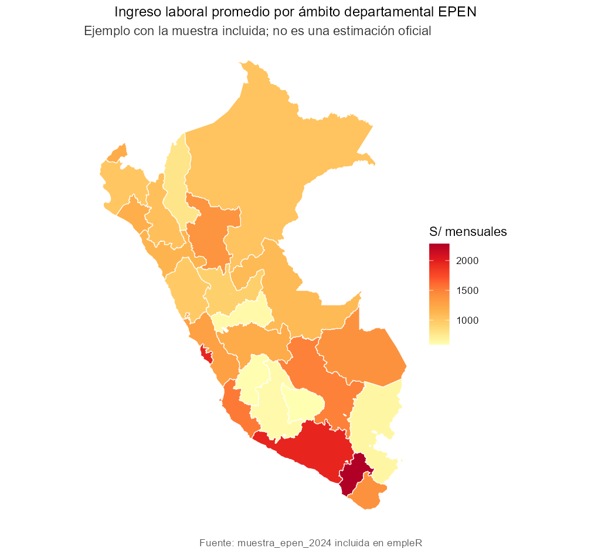
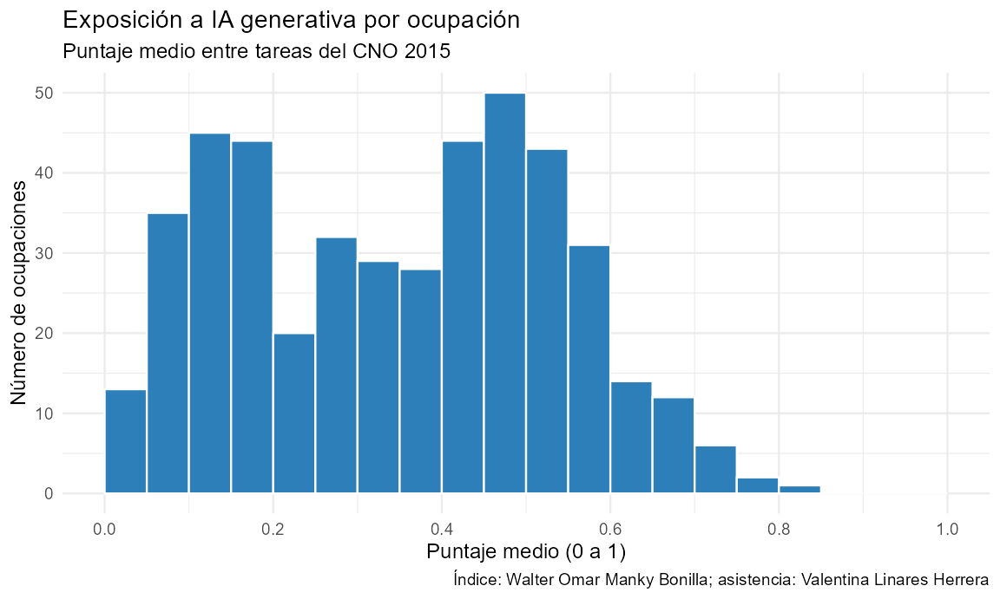

# empleR

[](https://github.com/valentinalinares/empleR/actions/workflows/R-CMD-check.yaml)
[](https://github.com/valentinalinares/empleR/actions/workflows/lint.yaml)
[](https://valentinalinares.github.io/empleR/)

`empleR` reúne herramientas para trabajar en R con las encuestas de empleo del
Perú. Permite descargar datos de la EPEN, interpretar códigos ocupacionales,
calcular indicadores ponderados y explorar los resultados en mapas. Está
pensado para estudiantes de pregrado y posgrado, docentes, investigadores y
analistas que usan microdatos del INEI.

La primera versión cubre la **EPE** de Lima Metropolitana y la **EPEN**
nacional. Complementa la documentación del INEI, no la reemplaza, y por ahora
no busca abarcar encuestas de otros países.

## ¿Qué problema resuelve?

En 2022 no solo cambió el nombre de la encuesta. La EPE cubría Lima
Metropolitana y clasificaba las ocupaciones con el CO-95; la EPEN tiene
cobertura nacional y usa el CNO 2015. Por eso, si trabajas con años de ambas
encuestas, conviene revisar cómo se corresponden sus códigos. `empleR` ayuda a
documentar esas diferencias y a reconocer qué correspondencias pueden
establecerse y cuáles siguen siendo ambiguas.

La [documentación completa](https://valentinalinares.github.io/empleR/)
incluye ejemplos, resultados y una explicación de los cambios entre la EPE y
la EPEN.

## Instalación

```r
pak::pak("valentinalinares/empleR")
```

## Un primer ejemplo

El paquete trae una muestra de 2.000 personas ocupadas de la EPEN 2024, así
que puedes correr los ejemplos sin descargar archivos grandes.

```r
library(empleR)

datos <- muestra_epen_2024 |>
  cno() |>
  ia_exposicion(score = "ambos", incluir_tipo = TRUE)

# Ingreso promedio por tipo de impacto de la IA
indicadores(datos, indicador = "ingreso_promedio", por = "ia_tipo")
```

### ¿Qué produce `mapa()`?



La figura se construyó con la muestra incluida en el paquete; no es una
estimación oficial del INEI.

## Sobre el índice de exposición a IA



El índice asigna a cada ocupación del CNO 2015 un puntaje continuo entre 0 y
1. Mide la exposición potencial de sus tareas a la IA, no la probabilidad de
que ese empleo desaparezca. Con `cobertura()` puedes comprobar cuántos
registros de tu base reciben un puntaje.

El índice fue desarrollado por Walter Omar Manky Bonilla, con asistencia de
investigación de Valentina Linares Herrera. Es una actualización del estudio
[*Doble desafío tecnológico*](https://www.gob.pe/institucion/inei/informes-publicaciones/7453406-doble-desafio-tecnologico-analisis-de-la-exposicion-a-la-automatizacion-tradicional-y-a-la-inteligencia-artificial-generativa-en-el-empleo-peruano-utilizando-datos-de-la-enaho-2024),
publicado por el INEI en 2025. La corrida incluida en el paquete se hizo en
abril de 2026 con Claude Sonnet 4.6, y su paquete metodológico se versionó el
15 de junio de 2026. Los nuevos puntajes no deben atribuirse al INEI.

## Funciones principales

| Función | Para qué sirve |
|---|---|
| `catalogo()` | Consulta las fuentes, años, variantes y periodos procesados por el proyecto. |
| `descargar()` | Descarga el módulo de empleo e ingresos de la EPEN y permite guardarlo en caché. Por ahora solo funciona con la EPEN. |
| `etiquetar()` | Convierte los códigos de las bases procesadas en categorías legibles. |
| `cno()` | Describe ocupaciones del CNO 2015 y homologa el CO-95 sin forzar los casos ambiguos. Conserva los candidatos y el estado de cada correspondencia. |
| `ia_exposicion()` | Añade a cada ocupación su puntaje de exposición a IA. |
| `cobertura()` | Muestra cuántas observaciones, y cuánta población ponderada, tienen código, homologación y puntaje. |
| `indicadores()` | Calcula ingreso y horas ponderados. Los errores estándar todavía son provisionales. |
| `resumen_nacional()` | Consulta indicadores nacionales precalculados y documentados. |
| `mapa()` | Muestra indicadores agregados en mapas estáticos o interactivos. Se recomienda usarlo a nivel departamental. |

`panel()` está disponible como herramienta **experimental** para revisar
viviendas u hogares que aparecen más de una vez. Por sí sola no identifica a la
misma persona y no forma parte del uso recomendado en la primera versión
estable.

## Contexto y trabajo relacionado

`empleR` no es el primer paquete para microdatos del Perú.
[`enaho`](https://cran.r-project.org/package=enaho) descarga y combina la
ENAHO y otras encuestas del INEI. En Argentina,
[`eph`](https://packages.ropensci.org/eph) es un antecedente valioso para
trabajar con una encuesta laboral permanente.

Lo propio de `empleR` es su foco en la EPE y la EPEN, y en el paso del CO-95
al CNO 2015. Mantiene visibles las correspondencias ambiguas y permite vincular
las ocupaciones con un índice peruano de exposición a IA.

## Qué conviene tener en cuenta

- `descargar()` trabaja solo con la EPEN. Para trabajar con la EPE, necesitas
  contar con los archivos históricos. La ENAHO aparece en `catalogo()` como
  parte del inventario del proyecto, pero todavía no se puede descargar desde
  el paquete.
- `etiquetar()` reconoce los nombres más comunes de las bases procesadas, pero
  no renombra todas las variables crudas del módulo 76.
- `indicadores()` produce estimaciones ponderadas y reconstruye el diseño
  muestral, así que sus errores estándar son reproducibles. Aún no se ha
  comprobado que reproduzcan los errores estándar publicados por el INEI.
- La primera versión estable no incluye análisis longitudinales de personas ni
  encuestas de otros países.

## Desarrollo

El proyecto usa pruebas automatizadas, `R CMD check`, `lintr` y `pkgdown`. Si
quieres contribuir o reportar un problema, puedes abrir un
[issue en GitHub](https://github.com/valentinalinares/empleR/issues).
