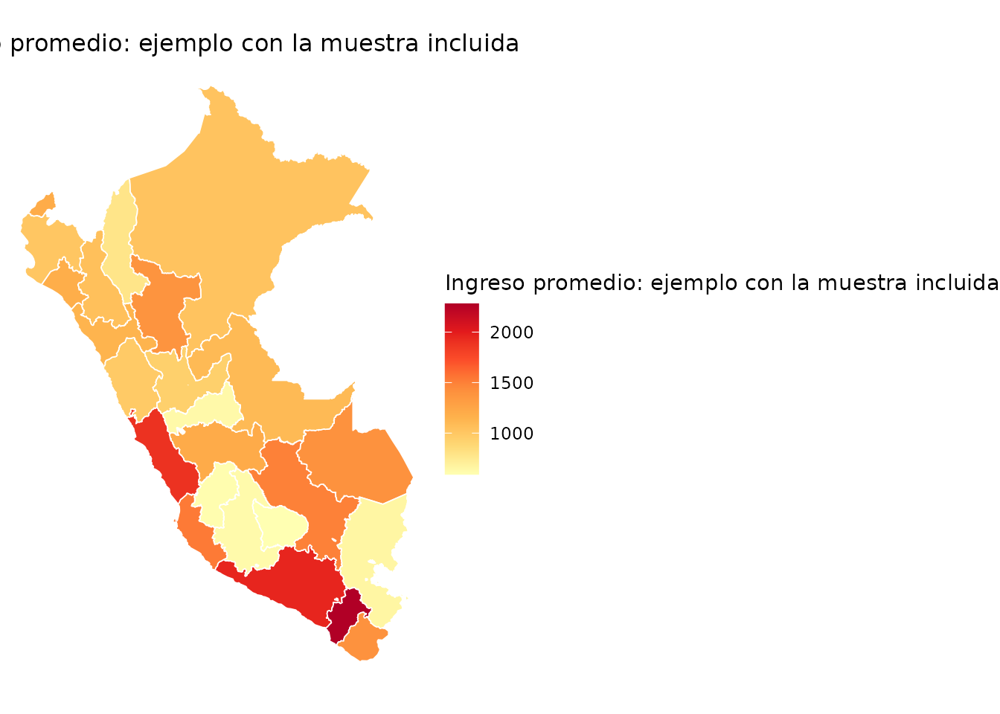

# Funciones, ejemplos y resultados

``` r

library(empleR)
```

Esta guía muestra qué recibe cada función, qué devuelve y cuáles son sus
límites. Los ejemplos usan datos incluidos en el paquete para ser
reproducibles.

## Descubrir y descargar datos

### `catalogo()`

Permite saber qué fuente, variante, año y periodo ha procesado el
proyecto. La descarga automática de esta versión se limita a EPEN; las
entradas ENAHO son parte del inventario y no implican que
[`descargar()`](https://valentinalinares.github.io/empleR/reference/descargar.md)
pueda obtenerlas.

``` r

catalogo(fuente = "EPEN", variante = "departamentos_anual")
#> # A tibble: 4 × 6
#>   fuente variante             year periodo            filas codigos_ocup
#>   <chr>  <chr>               <dbl> <chr>              <dbl>        <dbl>
#> 1 EPEN   departamentos_anual  2022 Anual - (Ene-Dic) 192416          439
#> 2 EPEN   departamentos_anual  2023 Anual - (Ene-Dic) 196595          449
#> 3 EPEN   departamentos_anual  2024 Anual - (Ene-Dic) 200630          434
#> 4 EPEN   departamentos_anual  2025 Anual - (Ene-Dic) 207407          438
```

### `descargar()`

Descarga el módulo de empleo e ingresos de la EPEN y devuelve sus
variables originales. Puede guardar una copia local para evitar repetir
la descarga.

``` r

epen_2024 <- descargar(
  year = 2024,
  destfile = "datos/epen_2024.rds"
)
```

La función no descarga la EPE histórica. Para esa encuesta, la persona
usuaria debe aportar su archivo.

## Hacer legibles y comparables las variables

### `etiquetar()`

Convierte códigos de las bases procesadas en factores o texto. Una
etiqueta de valor mantiene la variable compacta —por ejemplo, `1` y `2`—
pero muestra su significado —`Hombre` y `Mujer`— durante el análisis.

``` r

etiquetada <- etiquetar(
  muestra_epen_2024[1:6, ],
  vars = c("sex_code", "education_code")
)
#> ✔ 2 variable(s) etiquetadas.
etiquetada[c("sex_code", "education_code")]
#> # A tibble: 6 × 2
#>   sex_code education_code                  
#>   <fct>    <fct>                           
#> 1 Mujer    Sup. no universitaria completa  
#> 2 Hombre   Secundaria incompleta           
#> 3 Mujer    Primaria incompleta             
#> 4 Mujer    Sin nivel                       
#> 5 Hombre   Primaria incompleta             
#> 6 Hombre   Sup. no universitaria incompleta
```

En esta versión,
[`etiquetar()`](https://valentinalinares.github.io/empleR/reference/etiquetar.md)
reconoce nombres comunes de las bases procesadas. No etiqueta
automáticamente todas las columnas originales del módulo 76.

### `cno()`

Añade código y descripción del CNO 2015. Con EPE puede homologar CO-95
mediante la tabla oficial sin inventar una asignación en los casos
ambiguos.

``` r

ocupaciones <- cno(muestra_epen_2024[1:6, ])
#> ℹ Clasificador segun la encuesta de la base: CNO_2015
ocupaciones[c("occupation_code_raw", "cno_cod", "cno_desc")]
#> # A tibble: 6 × 3
#>   occupation_code_raw cno_cod cno_desc                                          
#>                 <dbl> <chr>   <chr>                                             
#> 1                5212 5212    Vendedores minoristas en tiendas y establecimient…
#> 2                6114 6114    Agricultores y trabajadores calificados de cultiv…
#> 3                9111 9111    Limpiadores y asistentes domésticos               
#> 4                9211 9211    Peones de explotaciones agrícolas y ganaderas     
#> 5                6114 6114    Agricultores y trabajadores calificados de cultiv…
#> 6                7231 7231    Mecánicos y reparadores de vehículos de motor
```

Ejemplo mínimo con un código CO-95 de múltiples destinos:

``` r

epe_ejemplo <- data.frame(
  source = "EPE",
  year = 2019,
  p204a = "262"
)
cno(epe_ejemplo, homologar = TRUE)[
  c("cno_cod", "cno_homologado", "cno_candidatos", "homologacion_estado")
]
#> ℹ Clasificador segun la encuesta de la base: CO_95
#> ✔ Columna cno_homologado agregada con equivalencias CNO 2015.
#> ℹ 0% de las filas tiene una equivalencia unica.
#> ℹ Los casos con varios destinos quedan en NA; ver cno_candidatos y
#>   homologacion_estado.
#>   cno_cod cno_homologado cno_candidatos homologacion_estado
#> 1     262           <NA>     2412; 2631  multiples_destinos
```

## Incorporar el índice de exposición a IA

### `ia_exposicion()`

Une cada ocupación CNO válida con un puntaje continuo de 0 a 1. También
puede incorporar la mediana, dispersión y el tipo de exposición
predominante.

``` r

con_ia <- muestra_epen_2024 |>
  cno() |>
  ia_exposicion(score = "ambos", incluir_tipo = TRUE)
#> ℹ Clasificador segun la encuesta de la base: CNO_2015
#> Warning: ℹ Filas con score de IA: 1961 (98%).
#> ! 39 (2%) con codigo CNO sin score en el indice.
#> ℹ Resumen por encuesta y ano: `cobertura()`.

con_ia[1:6, c(
  "cno_cod", "cno_desc", "ia_score_mean", "ia_score_median", "ia_tipo"
)]
#> # A tibble: 6 × 5
#>   cno_cod cno_desc                         ia_score_mean ia_score_median ia_tipo
#>   <chr>   <chr>                                    <dbl>           <dbl> <chr>  
#> 1 5212    Vendedores minoristas en tienda…        0.599            0.617 A      
#> 2 6114    Agricultores y trabajadores cal…        0.264            0.242 N      
#> 3 9111    Limpiadores y asistentes domést…        0.0625           0.05  N      
#> 4 9211    Peones de explotaciones agrícol…        0.05             0.05  N      
#> 5 6114    Agricultores y trabajadores cal…        0.264            0.242 N      
#> 6 7231    Mecánicos y reparadores de vehí…        0.238            0.15  N
```

El puntaje no es una probabilidad de pérdida de empleo. Mide exposición
potencial de tareas a herramientas de IA generativa.

### `cobertura()`

Antes de resumir el índice conviene medir qué parte de la muestra tiene
código, homologación y puntaje.

``` r

cobertura(con_ia)
#> Warning: 81 fila(s) con weight NA no suman poblacion.
#>   source year    estado detalle    n pct_n  poblacion pct_poblacion
#> 1   EPEN 2024 con_score    <NA> 1961 98.05 165010.121         97.26
#> 2   EPEN 2024 sin_score    <NA>   39  1.95   4651.136          2.74
```

## Calcular y consultar indicadores

### `indicadores()`

Calcula medias y medianas ponderadas de ingresos y horas, a nivel
nacional o por grupos.

``` r

indicadores(
  con_ia,
  indicador = "ingreso_promedio",
  por = "sex"
)
#> Warning: 81 filas eliminadas por peso NA o cero.
#> ℹ Diseno muestral provisional: estrato strata_code y UPM .upm; ver
#>   `?indicadores`.
#> This message is displayed once per session.
#>           sex        indicador estimado error_std
#> Hombre Hombre ingreso_promedio 1606.021  71.54815
#> Mujer   Mujer ingreso_promedio 1209.925  71.30004
```

Los estimados puntuales usan el factor disponible. Los errores estándar
se calculan con una reconstrucción reproducible del estrato y la UPM,
pero deben considerarse **provisionales**: todavía no han sido
reproducidos contra todas las precisiones oficiales del INEI.

### `resumen_nacional()`

Consulta una tabla incluida de indicadores ya calculados por el
proyecto.

``` r

resumen_nacional(
  "EPEN",
  year = 2024,
  variante = "departamentos_anual"
)[, c(
  "year", "activity_rate_pet", "employment_rate_pet",
  "unemployment_rate_pea"
)]
#> # A tibble: 1 × 4
#>    year activity_rate_pet employment_rate_pet unemployment_rate_pea
#>   <dbl>             <dbl>               <dbl>                 <dbl>
#> 1  2024             0.698               0.659                0.0557
```

La tabla debe citarse como un producto del pipeline del proyecto, no
como una API oficial del INEI.

## Visualizar resultados

### `mapa()`

Recibe un indicador ya agregado y lo une con los polígonos geográficos.
El nivel departamental es el recorrido probado y recomendado.

``` r

ingreso_dep <- indicadores(
  muestra_epen_2024,
  "ingreso_promedio",
  por = "region_code"
)
ingreso_dep$departamento <-
  shapes_departamentos$departamento[ingreso_dep$region_code]

mapa(
  ingreso_dep,
  var = "estimado",
  tipo = "ggplot",
  titulo = "Ingreso promedio: ejemplo con la muestra incluida"
)
#> ℹ Preparando shapes (departamento) via geoperu...
```



Este gráfico demuestra el funcionamiento de la función. La muestra de
ejemplo no debe utilizarse como estimación departamental oficial.

## Función experimental

### `panel()`

[`panel()`](https://valentinalinares.github.io/empleR/reference/panel.md)
ayuda a auditar hogares o viviendas que comparten una clave entre
periodos. No identifica por sí sola a una misma persona y todavía
requiere validar muestra, región y variables de panel en cada entrega.
Se conserva como referencia experimental, pero queda fuera del recorrido
recomendado de la primera versión estable.
