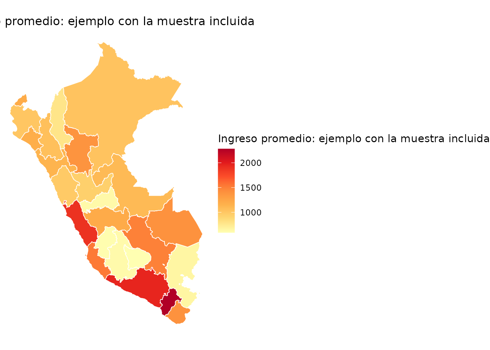

# Indicadores ponderados y mapas

``` r

library(empleR)
```

Esta parte del manual muestra cómo obtener estimaciones ponderadas,
consultar resultados nacionales ya calculados y representar indicadores
por departamento.

## `indicadores()`: calcular ingresos y horas ponderados

### Para qué sirve

[`indicadores()`](https://valentinalinares.github.io/empleR/reference/indicadores.md)
calcula el ingreso laboral promedio o mediano y las horas semanales
promedio. Puede obtener un resultado nacional o separar la estimación
por sexo, región u otras variables de la base.

### Qué recibe

| Argumento    | Uso                                                          |
|--------------|--------------------------------------------------------------|
| `data`       | Base con la variable del indicador y un factor de expansión. |
| `indicador`  | `ingreso_promedio`, `ingreso_mediano` u `horas_promedio`.    |
| `por`        | Una o varias variables para formar grupos.                   |
| `var_strata` | Nombre del estrato si no se detecta automáticamente.         |
| `var_psu`    | Nombre de la unidad primaria de muestreo.                    |
| `var_peso`   | Nombre del factor de expansión.                              |

### Qué hace por dentro

1.  Detecta el peso, el estrato y el conglomerado disponibles.
2.  Elimina del cálculo las filas cuyo peso es ausente o no positivo.
3.  Cuando existen las variables necesarias, construye una UPM con
    muestra, región y conglomerado.
4.  Crea un diseño con el paquete `survey`.
5.  Calcula el indicador y su error estándar para el total o para cada
    grupo.

### Qué devuelve

El resultado contiene el nombre del indicador, `estimado` y `error_std`.
Si usas `por`, conserva además las columnas que identifican cada grupo.

``` r

ingreso_sexo <- indicadores(
  muestra_epen_2024,
  indicador = "ingreso_promedio",
  por = "sex"
)
#> Warning: 81 filas eliminadas por peso NA o cero.
#> ℹ Diseno muestral provisional: estrato strata_code y UPM .upm; ver
#>   `?indicadores`.
#> This message is displayed once per session.
ingreso_sexo
#>           sex        indicador estimado error_std
#> Hombre Hombre ingreso_promedio 1606.021  71.54815
#> Mujer   Mujer ingreso_promedio 1209.925  71.30004
```

También puedes calcular más de una agrupación:

``` r

indicadores(
  muestra_epen_2024,
  indicador = "horas_promedio",
  por = c("sex", "is_rural")
)
#> Warning: 81 filas eliminadas por peso NA o cero.
#>             sex is_rural      indicador estimado error_std
#> Hombre.0 Hombre        0 horas_promedio 41.67798 0.9767129
#> Mujer.0   Mujer        0 horas_promedio 38.26529 1.3356709
#> Hombre.1 Hombre        1 horas_promedio 33.24925 1.7495960
#> Mujer.1   Mujer        1 horas_promedio 30.51582 1.8736565
```

### Cómo interpretar el resultado

`estimado` incorpora el factor de expansión, por lo que no equivale al
promedio simple de las filas. `error_std` describe la precisión bajo el
diseño reconstruido por el paquete. Debe tratarse como provisional:
todavía no se ha comprobado que esa reconstrucción reproduzca los
errores estándar publicados por el INEI.

La muestra incluida contiene únicamente personas ocupadas. Es adecuada
para practicar con ingreso y horas, pero no para calcular tasas de
actividad, empleo o desempleo.

## `resumen_nacional()`: consultar resultados precalculados

### Para qué sirve

[`resumen_nacional()`](https://valentinalinares.github.io/empleR/reference/resumen_nacional.md)
permite consultar indicadores que el proyecto ya calculó con las bases
completas. Incluye tasas que requieren ocupados, desocupados e
inactivos, además de ingresos y horas.

### Qué recibe y qué devuelve

Puedes filtrar por fuente, año y variante. La función devuelve las filas
del dataset interno `indicadores_epen` que cumplen esos criterios.

``` r

tasas_2024 <- resumen_nacional(
  fuente = "EPEN",
  year = 2024,
  variante = "departamentos_anual"
)

tasas_2024[, c(
  "year", "activity_rate_pet", "employment_rate_pet",
  "unemployment_rate_pea"
)]
#> # A tibble: 1 × 4
#>    year activity_rate_pet employment_rate_pet unemployment_rate_pea
#>   <dbl>             <dbl>               <dbl>                 <dbl>
#> 1  2024             0.698               0.659                0.0557
```

Estos resultados son productos reproducibles del pipeline del proyecto.
Al citarlos, identifica la fuente y la variante; no los presentes como
una API o una tabla oficial publicada directamente por el INEI.

## `mapa()`: representar un indicador agregado

### Para qué sirve

[`mapa()`](https://valentinalinares.github.io/empleR/reference/mapa.md)
une una tabla de resultados con los polígonos geográficos del Perú y
produce un mapa estático o interactivo. La función espera datos ya
agregados; no calcula el indicador dentro del mapa.

### Qué recibe

| Argumento | Uso |
|----|----|
| `data` | Tabla con una fila por unidad geográfica. |
| `var` | Columna numérica que se representará con colores. |
| `nivel` | Departamento, provincia o distrito. |
| `tipo` | `ggplot` para una figura estática o `leaflet` para un mapa interactivo. |
| `titulo` | Título del mapa y de la leyenda. |
| `paleta` | Paleta de colores. |
| `shapes` | Polígonos propios si no deseas usar los incluidos. |

### Qué hace por dentro

1.  Obtiene los polígonos del nivel geográfico solicitado.
2.  Detecta la columna que permite unir los resultados con esos
    polígonos.
3.  Añade el indicador a cada unidad geográfica y avisa si alguna queda
    sin dato.
4.  Construye un objeto `ggplot` o `leaflet`.

### Ejemplo de aplicación

``` r

ingreso_dep <- indicadores(
  muestra_epen_2024,
  indicador = "ingreso_promedio",
  por = "region_code"
)

ingreso_dep$departamento <-
  shapes_departamentos$departamento[ingreso_dep$region_code]

mapa(
  ingreso_dep,
  var = "estimado",
  tipo = "ggplot",
  titulo = "Ingreso promedio: ejemplo con la muestra incluida"
)
#> ℹ Preparando shapes (departamento) via geoperu...
```



El mapa demuestra el funcionamiento de la función. La muestra de 2.000
personas no ofrece estimaciones departamentales oficiales. Para
resultados sustantivos debes usar la base completa, comprobar el ámbito
de estimación y revisar la cobertura de cada departamento.

El nivel departamental es el recorrido validado en esta versión. Si
trabajas a nivel provincial o distrital, revisa de manera explícita las
llaves geográficas y los dominios que permite el diseño de la encuesta.
